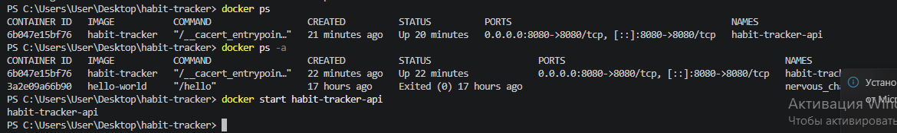
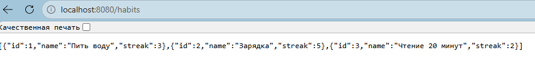
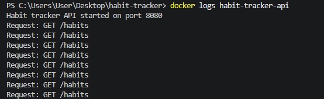
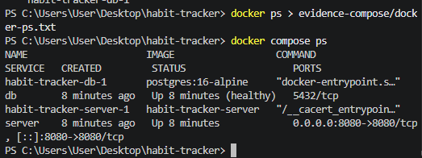
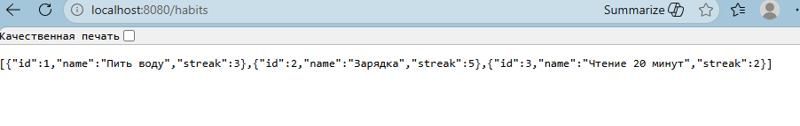
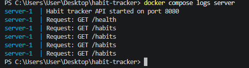
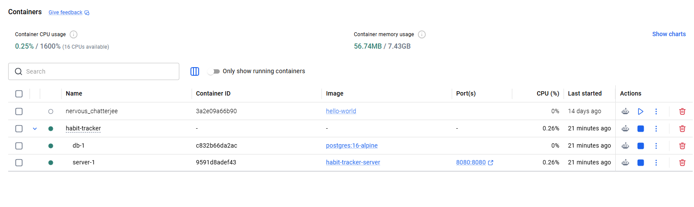

# Трекер привычек

Проект для учёта ежедневных привычек. В этой работе добавлено простое API
на Java, упакованное в Docker-контейнер.

Статус: API работает в Docker (v0.3.0)

## Структура проекта

| Файл | Назначение |
|---|---|
| App.java | исходный код API |
| Dockerfile | инструкция сборки Docker-образа |
| .dockerignore | файлы, которые не попадают в образ |
| habits.md | таблица трекера привычек |
| evidence/ | результаты проверки (docker ps, ответ API, docker logs) |

## Эндпоинты

| Метод | Путь | Описание |
|---|---|---|
| GET | /health | проверка работоспособности |
| GET | /habits | список привычек |

## Запуск без Docker

```
javac App.java
java App
```

После запуска API доступно по адресу http://localhost:8080/habits

## Сборка Docker-образа

```
docker build -t habit-tracker .
```

## Запуск контейнера

```
docker run -d --name habit-tracker-api -p 8080:8080 habit-tracker
```

## Проверка

Работающий контейнер:

```
docker ps
```

Ответ API:

```
curl http://localhost:8080/health
curl http://localhost:8080/habits
```

Логи контейнера:

```
docker logs habit-tracker-api
```

Содержимое контейнера:

```
docker exec habit-tracker-api ls -la /app
```

## Остановка и удаление контейнера

```
docker stop habit-tracker-api
docker rm habit-tracker-api
```

## Результаты проверки

- Вывод docker ps: [evidence/docker-ps.txt](evidence/docker-ps.txt)
- Ответ API: [evidence/api-response.txt](evidence/api-response.txt)
- Вывод docker logs: [evidence/docker-logs.txt](evidence/docker-logs.txt)

Скриншоты:





## Прошлая работа

- Описание конфликта слияния: [git-conflict.md](git-conflict.md)

## Запуск через Docker Compose

Проект состоит из двух сервисов: `server` (Java API) и `db` (PostgreSQL).
Данные БД хранятся в томе `db-data`, пароль передаётся через секрет.

Перед запуском создайте файл `db-password.txt` с паролем для БД
(в репозитории его нет, он исключён через .gitignore).

Сборка и запуск:

```
docker compose up --build
```

Проверка:

```
docker ps
curl http://localhost:8080/health
curl http://localhost:8080/habits
docker compose logs
```

Остановка:

```
docker compose stop
```

Результаты проверки:

- [docker ps](evidence-compose/docker-ps.txt)
- [ответ API](evidence-compose/api-response.txt)
- [логи](evidence-compose/compose-logs.txt)





